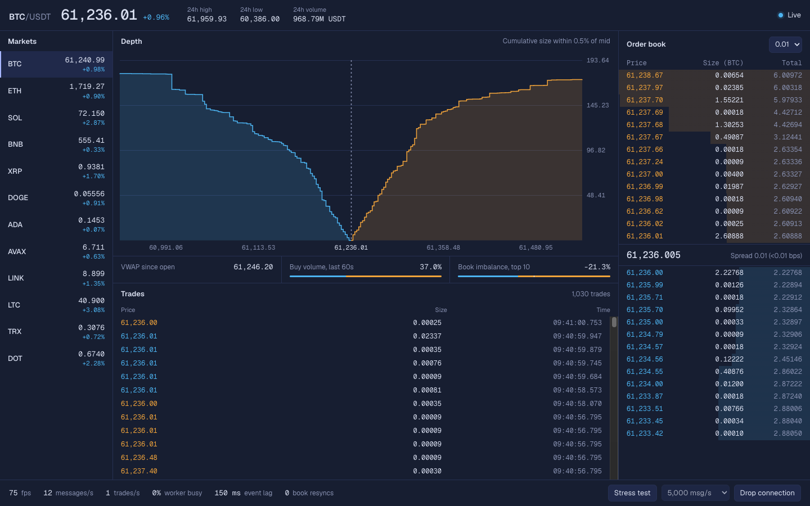
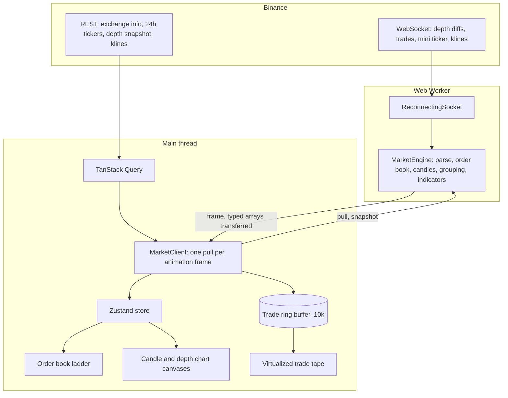

# Market Terminal

A live crypto market screen in the browser: price candles, order book, depth chart, trade tape and order flow for 12 Binance spot pairs. It reads Binance's public market data directly and has no backend of its own.

Open it at [arthurfrollini.github.io/market-terminal](https://arthurfrollini.github.io/market-terminal/). Add `?stress=1` to start with the simulated 5,000 msg/s feed.



## What it does

- Keeps a local copy of the Binance order book from a REST snapshot plus the 100 ms diff stream. When an update skips ahead in the sequence, the book throws itself away and resyncs; the status bar counts every resync.
- Shows the top of the book as a ladder you can group by price step, with the spread in price and basis points.
- Draws candles on a canvas at 1m, 5m, 15m or 1h, with EMA 20 over the price, RSI 14 below and the candle under the pointer in a legend. History comes from REST and the current candle from the kline stream. Changing the interval swaps the subscription on the open socket, so the order book doesn't lose its sync.
- Draws the cumulative depth within 0.5% of the mid on a canvas, with a crosshair and tooltip on hover. It shares a tab with the candles.
- Lists every trade in a virtualized tape that holds the last 10,000. Scroll down and the list stays put while new trades arrive, with a button to jump back to the latest.
- Computes VWAP since the stream opened, the buy share of volume over the last 60 s and the imbalance of the top 10 book levels.
- Reconnects on its own after a dropped connection, and also after 10 s of silence, which catches a socket that looks open but has stopped delivering. "Drop connection" in the status bar cuts the socket so you can watch it recover.
- Stress test mode swaps the live feed for a simulated one at 1,000, 5,000 or 20,000 messages per second, in Binance's own JSON format, so the browser still parses every message.

## How it's built

React 19, TypeScript, Vite, TanStack Query, TanStack Virtual and Zustand. Tests run on Vitest and Playwright.



The main thread never touches the socket. A Web Worker owns the connection, parses the JSON, keeps the order book in sync and aggregates it. On each animation frame the UI asks the worker for whatever changed since the last frame, and only one request is in flight at a time. If the UI falls behind, messages pile up in the worker and collapse into the next frame instead of queueing on the main thread. Book levels and depth curves travel as typed arrays that are transferred, not copied.

A kline event carries the whole current candle, so the worker replaces each candle by its open time. REST history and stream updates can arrive in either order without counting anything twice. On every reconnect the worker starts the series over and asks for history again, so candles that closed while it was offline come from REST. EMA and RSI are computed in the worker, and the candles travel to the UI as transferred typed arrays like the book.

On the main thread, trades go into a ring buffer outside React state, and the store only holds a counter that tells the tape to re-render. Components select single fields from the store. The candle and depth charts subscribe to the store directly and redraw their canvas only when their data changes or the pointer moves, so React never re-renders them. Only the chart on the open tab is mounted.

TanStack Query fetches the pair's tick size once and keeps it, polls the 24h tickers for the market list every 10 s, and fetches order book snapshots and the last 500 candles without caching them. Retries skip 4xx responses, except 429.

| Folder | What's in it |
|---|---|
| `src/domain/` | Pure logic with no I/O: Binance message types, the order book, level grouping, depth curves, the candle series with EMA and RSI, indicators, the ring buffer |
| `src/net/` | The WebSocket wrapper with backoff and the silence watchdog |
| `src/worker/` | `MarketEngine`, which turns raw messages into frames and runs in tests without a worker, and the worker that wires it to the socket |
| `src/feed/` | The simulated feed for stress test mode |
| `src/market/` | The main-thread client, the Zustand store and the worker protocol |
| `src/api/` | REST queries |
| `src/components/` | The panels |
| `e2e/` | A local mock of Binance and the Playwright tests |

## Performance

Measured on a Mac in Chrome against the production build, reading the numbers the status bar shows.

| Feed | Frame rate | Worker busy | Event lag |
|---|---|---|---|
| Stress test, 5,000 msg/s | 75 fps | 1 to 3% | under 10 ms |
| Stress test, 20,000 msg/s | 75 fps | 4 to 11% | under 13 ms |
| Stress test, 20,000 msg/s, CPU throttled 4x in DevTools | 65 to 73 fps | 4% | under 13 ms |

75 fps is the display's refresh rate. DevTools throttling most likely slows only the main thread, so the worker figures in the last row are close to an unthrottled CPU. The book did not resync once in any of these runs. With the live BTC/USDT feed the event lag reads 150 to 200 ms, which includes the difference between the local clock and Binance's.

## Running it

You need Node.js 20.19+ or 22.12+.

```bash
npm install
npm run dev
```

Open `http://localhost:5173`. Add `?symbol=ETHUSDT` to start on another pair, or `?stress=1` to start in stress test mode.

## Checks

```bash
npm run typecheck
npm run lint
npm test        # Vitest: 177 tests
npm run coverage
npm run e2e     # Playwright: 9 tests
```

The unit tests cover the book sync rules (stale snapshots, gaps, buffered diffs), grouping, the candle series (history and stream merged in either order, EMA and RSI against values worked out by hand), the indicators, the socket's backoff and watchdog with fake timers, and 500 rounds of the simulated feed at 20,000 msg/s without a gap or a crossed book. The main-thread client runs against a fake worker and a fake `requestAnimationFrame`, which checks that only one pull is ever in flight and that a failed snapshot is retried. The worker entry point runs against a fake WebSocket, including the interval switch on the open socket and dropping klines for the old interval.

The components are tested with Testing Library in jsdom: the order book ladder, the trade tape with its scroll anchoring (with a stubbed viewport height so the virtualizer renders rows), the status bar controls, the market list, the chart tabs, and the candle and depth charts, whose canvas calls are recorded by a fake 2D context.

Coverage is 100% of lines and 92% of branches. `npm run coverage` fails below 95% of lines or 85% of branches.

The Playwright tests build the app in e2e mode and run it against a mock of Binance's REST and WebSocket endpoints served from one local Node process. They cover the book and its diffs, trades, reconnecting after the network drops, resyncing after a sequence gap, switching pairs, keeping 3,000 trades with only the visible rows in the DOM, stress test mode, and candles, including a switch to 5m on the same connection without a resync. The `?ws=` and `?rest=` overrides that point the app at the mock only exist in dev and e2e builds; the production build compiles them out.

GitHub Actions runs all of these on every pull request and every push to `main`. A push to `main` that passes is published to GitHub Pages.
